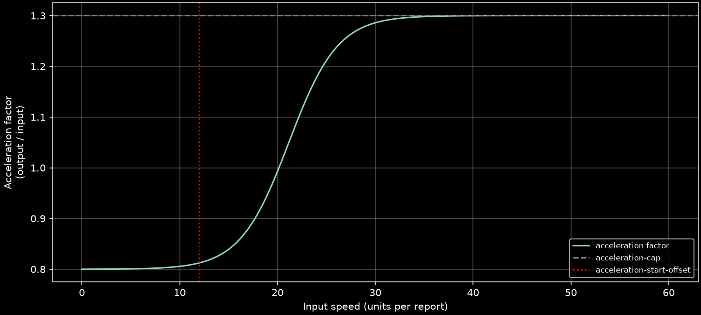
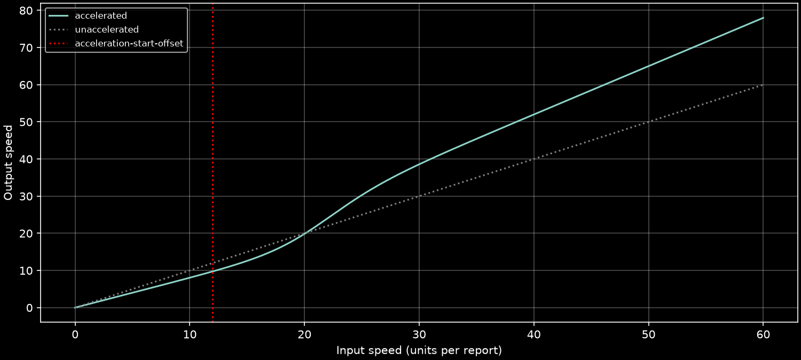
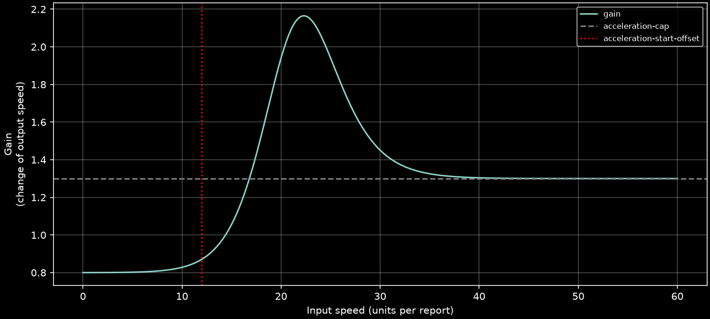
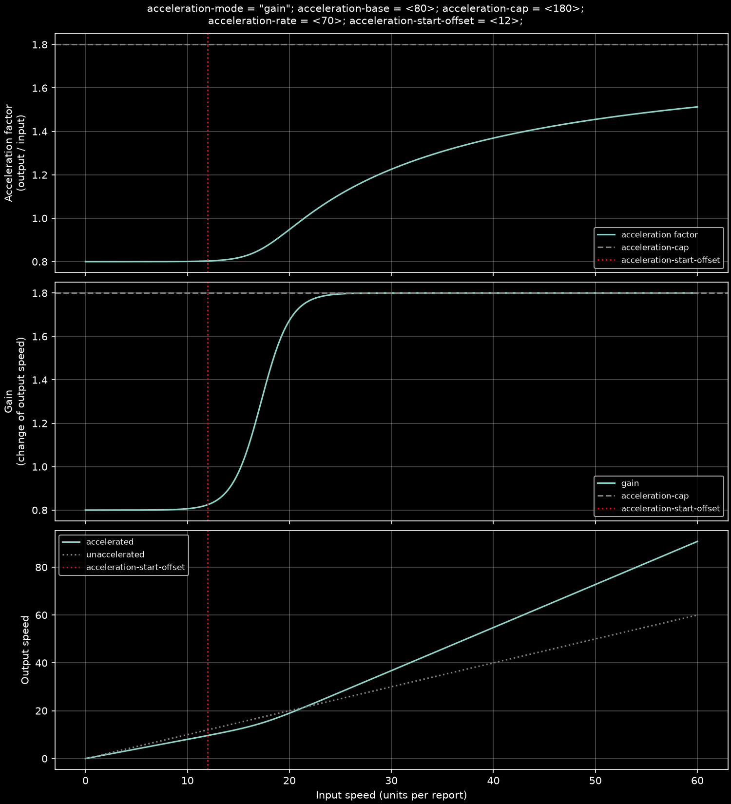

# ZMK Mouse Acceleration

This project adds mouse acceleration for pointing devices on keyboards running the [ZMK firmware](https://zmk.dev).

It should work with all pointing devices (mice, trackpads, trackball, etc.), but it was designed and optimized specifically for [Trackpoints using my PS/2 driver.](https://github.com/infused-kim/kb_zmk_ps2_mouse_trackpoint_driver)

This module was inspired by advanced mouse accelerators like [Raw Accel](https://github.com/RawAccelOfficial/rawaccel), which are used by competitive gamers to achieve both precision and speed.

> [!NOTE]
>
> **AI Usage Disclosure**
>
> The majority of the code for this project was hand-written back in 2024 before agentic coding was a thing.
>
> Most of the documentation was also handwritten.
>
> Later updates were created with the assistance of agents, but reviewed and approved manually. This is not a vibe-coded project.

## Table Of Contents <!-- omit from toc -->

- [1. What problem does this solve?](#1-what-problem-does-this-solve)
- [2. How this module works](#2-how-this-module-works)
  - [2.1. Acceleration Factor (Sensitivity)](#21-acceleration-factor-sensitivity)
  - [2.2. Output Speed](#22-output-speed)
  - [2.3. Gain](#23-gain)
  - [2.4. Acceleration Modes: Factor vs Gain](#24-acceleration-modes-factor-vs-gain)
- [3. Compatibility with ZMK versions](#3-compatibility-with-zmk-versions)
- [4. Setup Instructions](#4-setup-instructions)
  - [4.1. How to set up your zmk-config](#41-how-to-set-up-your-zmk-config)
  - [4.2. How to visualize acceleration settings](#42-how-to-visualize-acceleration-settings)
  - [4.3. How to tune your acceleration](#43-how-to-tune-your-acceleration)

## 1. What problem does this solve?

A core requirement for pointing devices is that they need to be both precise enough for fine work, but at the same time fast enough to travel across large, modern displays.

And although you can tweak the sensitivity of most mouse devices, it frequently leads to only one of these requirements being fulfilled.

This is an especially big problem on Trackpoints that are installed on mechanical keyboards because they usually require an extension of the stem to reach above the keycaps.

This messes with the leverage that is applied to the force sensor and significantly changes how it feels.

## 2. How this module works

There are many different ways to implement mouse acceleration. This is done by applying different _"acceleration curves"_. Some curves are better for some workflows than others.

The goal of this module is to create two fairly consistent zones of movement that allow you to build muscle memory for them:

1. Fine precision work at slow speeds
2. Fast movement

When you move your mouse it measures the distance of your movement and converts it into `x` and `y` values that instruct your computer to move the cursor.

The faster you move or the harder you press on your Trackpoint, the higher the `x` and `y` values.

This is called the `input speed`.

A mouse acceleration algorithm applies a mathematical function to determine an `acceleration factor`. This factor is then applied to the `input speed`, which produces an accelerated (or decelerated) `output speed`.

The acceleration is frequently visualized with three plots to make it easier to understand:

### 2.1. Acceleration Factor (Sensitivity)

This is the multiplier that is applied to the `input speed`.

It's also frequently referred to as `Sensitivity` (such as in Raw Accel).

However, not everything that is called "sensitivity" is the acceleration factor. For example, the sensitivity setting of Trackpoints refers to the force sensor sensitivity and not an acceleration factor.

So, to avoid confusion, I will be referring to it as the `acceleration factor`.

When the mathematical formula behind the algorithm is plotted, it shows us the `acceleration curve`.

Here is an example of a sigmoid curve that this module uses:

The `x-axis` shows the input speed in units per mouse report. It's calculated from the combined speed of both the `x` and `y` value that the pointing device sends.

And the `y-axis` shows the acceleration factor.

You can see that with this curve...

- At slow speeds of 0-12, the mouse movement is actually **slowed down** by 20% (acceleration factor of 0.8x)
- After that the acceleration factor grows smoothly to the maximum of 1.3x
- There, it stays for the remainder of the curve

And the module allows you to configure:

- The `start-offset` where the increase to the acceleration curve starts. This allows you to create a zone for precise work where the acceleration stays at the constant base factor. (Graph: 12)
- The `base` at which the acceleration starts (Graph: 0.8x)
- The `rate` at which the acceleration grows (Graph: 0.4)
- And the `cap` at which the acceleration stops (Graph: 1.3x)

### 2.2. Output Speed

The `input speed` is multiplied with the corresponding `acceleration factor` and produces the `output speed`. This is the actual value your computer receives and the amount by which your cursor moves.

It looks like this for the acceleration curve above:

The turquoise line is the accelerated speed and the dotted gray line is the original speed the pointing device sent.

As you can see, the mouse is actually slowed down before a speed of `20`. It only overtakes the original speed once the acceleration factor crosses `1.0x`.

### 2.3. Gain

Another useful plot to look at is `gain`:

The gain plot answers:

> If I move my hand a little faster, how much faster will my cursor jump on screen?

- A flat line means your cursor gets faster at a steady, predictable pace.
- A steep spike means your cursor suddenly jumps forward the moment your hand crosses a certain speed.
- A drop back down happens when you hit a "Cap" and your mouse stops accelerating.

Our plot shows a steep spike. Some people will like it because it rapidly accelerates the cursor to the fast range.

But many people will find it jerky and unpredictable because the gain overshoots the 1.3x acceleration cap.

Fortunately, there is a solution for it:

### 2.4. Acceleration Modes: Factor vs Gain

The plots I've shown you above all used the `factor mode`. This means the sigmoid function with our settings was applied to the `acceleration factor`.

However, when you switch to the `gain mode`, we apply the sigmoid function to the `gain` and then derive the `acceleration factor` (and curve) from the gain.

As you can see, this leads to a much smoother transition of acceleration that doesn't overshoot and will make your brain and muscle memory much happier.

> [!IMPORTANT]
> The `gain mode` is actually the default mode. I showed the `factor mode` first because it's easier to understand the difference this way.
>
> You also need to adjust the `start-offset`, `rate` and `cap` settings when switching between modes to get comparable acceleration because the `gain mode` produces much gentler acceleration curves.

## 3. Compatibility with ZMK versions

## 4. Setup Instructions

### 4.1. How to set up your zmk-config

### 4.2. How to visualize acceleration settings

### 4.3. How to tune your acceleration
